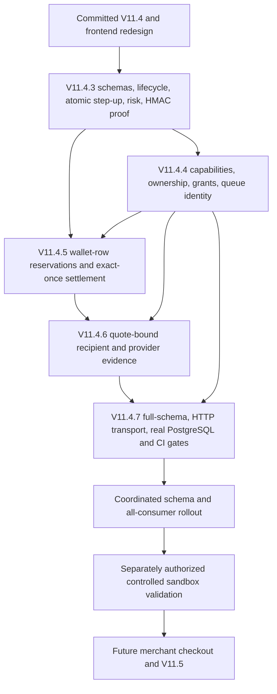

# V11.4.7 — Integration and Release Readiness

## Release decision

**NO-GO for production financial execution or public payment-capable Shopify MCP.**
The integrated source passes local policy, ownership, reservation, recipient and
receipt regressions, including real PostgreSQL connections. This supports review
of the combined change; it does not establish deployed schema, provider permissions,
live webhook behavior, browser usability or production readiness. No deployment,
production migration, payment, authorization, capture, refund, checkout or secret
inspection was performed. Provider financial responses were intercepted locally.

## Repository evidence and dependencies

At inspection, branch was `fix/verified-payee-binding`, HEAD
`e16a84c` (`feat(web): redesign IntentLock fintech frontend and transaction demo`).
The preceding committed baseline includes `980510c` (V11.4 refund recovery/test
infrastructure). V11.4.3–V11.4.6 reports and their additive migrations were untracked;
their source modifications were dirty working-tree changes. `git log --all --`
the four report paths returned no commits. None of these four releases can be
described as committed releases. Changing branches did not isolate this work.
Existing unrelated files were preserved. No commit, push or history change occurred.



The same quote must bind monetary/FX facts, catalog identity and recipient fingerprint.
An API policy token is not a wallet reservation or merchant checkout. A visitor
capability authorizes resource access; it is not provider settlement evidence.
Queue jobs carry server identity and recheck grants; provider webhooks authenticate
independently and must recover admitted obligations after visitor expiry/revocation.
Settlement converts a reservation into spent authority in one SQL transaction;
successful provider HTTP responses alone cannot create a debit or verified receipt.

## Source-proven integration gaps corrected

| Finding | Correction | Evidence |
| --- | --- | --- |
| Worker used legacy TypeScript decorators against the installed SDK's standard `ClassMethodDecoratorContext` contract | Select standard decorators; retain actual `@callable` methods | Strict compile and Wrangler bundling pass |
| API authentication union could return an undefined response | Narrow the actual response before returning | Strict compile; existing authentication regressions retained |
| Byte helper return annotations widened owned buffers to potentially shared buffers | Precisely annotate `Uint8Array<ArrayBuffer>` | Existing hash/HMAC tests and strict compile |
| Generated Cloudflare `Request.clone()` loses the source default CF generic | Narrow only the clone declaration to the source Request type; no request/body change | Worker boundary regressions and strict compile |
| Security Lab rendered an unknown value as a boolean React condition | Explicit non-null presence check | Frontend strict compile/build |
| Shopify silently defaulted missing currency to INR, coerced non-decimal money and assumed missing availability meant available | Validate provider decimal strings, currency and minor units; require explicit true availability | 16 commerce regressions |
| Shopify provenance fell back to merchant display text and requested variant identity was not checked against the response | Bind source to configured store/product/variant; reject another returned variant | Normalization and provider-read regressions |
| Redesigned runner and purchase readiness ignored active holds | Shared availability calculation subtracts reserved authority and rejects missing/malformed counters | Seven demo authority regressions |
| Prior release SQL suites used one embedded connection; CI lacked real PostgreSQL and strict checks | Optional loopback-only PostgreSQL harness, full migration validation and CI services/gates | 20 distinct backend connections; SQL and HTTP suites |

Shopify source provenance changes intentionally require a fresh quote for older
unexecuted Shopify contexts; old stored evidence is not rewritten. External checkout
was already prohibited. Catalog-policy ALLOW remains a provisional policy decision;
only durable SQL reservation admission admits competing financial execution. Do not
subtract a session's own hold a second time during its capture revalidation.

## Migration order, repeatability and compatibility

`apps/worker/db/release-order.json` records the complete fresh-database order:

1. `schema.sql`
2. `v7_payment_links.sql`
3. `v10_1_intent_wallets.sql`
4. `v10_2_step_up.sql`
5. `v10_4_purchase_sessions.sql`
6. `v10_5_whatsapp.sql`
7. `v10_6_payment_proof.sql`
8. `v10_8_authorize.sql`
9. `v10_8_4_audit_mirror_fix.sql`
10. `v10_9_agent_trust_risk.sql`
11. `v11_0_paypal_provider.sql`
12. `v11_0_1_multi_currency.sql`
13. `v11_0_2_capture_retry.sql`
14. `v11_0_3_late_capture.sql`
15. `v11_4_post_purchase_guard.sql`
16. `v11_4_4_financial_access.sql`
17. `v11_4_5_wallet_reservations.sql`
18. `v11_4_6_verified_recipient.sql`

There is no V11.4.3 or V11.4.7 production schema migration. Relative to a fully
installed committed V11.4 schema, pending additions are .4, .5, then .6. The actual
deployed baseline was deliberately not inspected; reconcile its migration records
and catalog before choosing pending files. Never blindly replay the fresh order.

The new disposable-only validator creates a random database on `127.0.0.1` using
the dedicated `intentlock_test` role, and drops only that database in cleanup. It
never reads DATABASE_URL or credential files. Example:

```text
node apps/worker/scripts/validate-release-postgres.mjs 55447
```

PostgreSQL 17.6 applied all 18 exact files. In the disposable journal, each migration
and SHA-256 checksum is committed under a transaction/advisory lock. A second pass
applied zero files. The validator removes only existing outer BEGIN/COMMIT wrappers
to put .5/.6 in the journal transaction. A raw rerun of .4 was separately rejected
with duplicate-table SQLSTATE 42P07 and rolled back. The original scripts are
**one-shot**, not generally idempotent; the test journal is not a production migration
service or permission to rerun ALTER FUNCTION renames. Review deployment migration
tracking/checksums independently.

Read-only rollout preflight must identify already-overdrawn wallets, outstanding
unreserved historical payments, unbound recipient holds, existing partial schema,
duplicate provider IDs and installed function signatures. The .5 invariant constraint
can reject inconsistent historical rows: stop and investigate; never adjust financial
records to force migration success. No owner or recipient backfill is inferred.
Historical receipts/ledgers remain unchanged; unbound unsettled payments require
controlled reconciliation. Missing access/reservation/recipient schema fails closed.

Do not run old writers beside the new schema. .6 wraps .5 functions and retains
internal predecessor implementations; those helpers are not public APIs. Restrict
database roles and credentials to trusted server consumers. A partially installed
or mixed-version release is a deployment failure, not a reason for bypassing guards.

Rollback: freeze new financial actions, drain invocations/jobs, preserve current
settlement-compatible code and every ledger/reservation/receipt/provider observation.
Reconcile outstanding obligations before considering any schema removal. Do not
deploy pre-reservation/pre-recipient writers or drop evidence as rollback. Prefer
forward correction; restore infrastructure only through a reviewed recovery plan
that accounts for provider movements after any database backup.

## Financial and access evidence matrix

| Boundary | Result | Scope and limitations |
| --- | --- | --- |
| Full migration dependency chain | PASS | Disposable PostgreSQL 17.6; 18 files, repeat journal skips 18; raw duplicate rejected atomically |
| 20 competing sessions | PASS | 20 distinct PostgreSQL backend PIDs in the full schema; 14 x $7 admitted, six rejected, reserved $98, spent $0, authority $100 |
| Two $70 sessions / same-session retries | PASS | Actual SQL suites; only one admission, one reservation per session |
| Duplicate settlement, no duplicate ledger/debit | PASS | Recipient/reservation SQL replay suites on real PostgreSQL; provider evidence mocked |
| Ambiguous capture, failure, expiry, revocation, step-up races | PASS | Existing SQL/service regressions retained; uncertain authority remains held; no timeout-only release |
| Anonymous issuance and cross-visitor isolation | PASS | Actual frontend transport -> exported Worker -> full schema; isolated browser storage instances, no signup |
| Expiry/revoke/replay/forgery and quotas | PASS | Ownership, capability rotation, nonce, SQL rate counter and API/queue regressions |
| API / WhatsApp grant compatibility | PASS (automated) | Existing signed/client and paired-chat grant contracts; no live chat/provider validation |
| Recipient quote -> order -> authorization/capture -> proof | PASS (automated) | Existing provider-contract, SQL, proof and service tests; missing/mismatch/unknown registry denied |
| Full mocked-provider checkout preparation | PASS | Actual PayPal adapter, SQL authority hold and recipient evidence; only OAuth/create/order-read fetch responses intercepted |
| Verified receipt before settlement | PASS | HTTP integration returns PROOF_NOT_READY/404 and zero ledger entries after preparation; signature/hash/recipient tamper suites retained |
| Browser-rendered/mobile/loading/error/retry/disconnected flow | NOT VERIFIED | Both requested computer-use initialization and browser surface failed: `failed to write kernel assets ... path specified ... os error 3` |
| Actual PayPal account, API permissions and webhook contracts | NOT VERIFIED | No provider mutations or deployed credential inspection |
| Cloudflare distributed queues/DO/Upstash/Neon behavior | NOT VERIFIED | Bundling and isolated mocks/SQL are not distributed deployment evidence |
| Shopify Global Catalog MCP | NOT IMPLEMENTED / checkout disabled | Existing connector is Storefront GraphQL discovery, not Global Catalog MCP |
| Dependency advisory gate | FAIL | Latest npm audit: 17 affected packages, two critical, 11 high, four moderate; see risks |

The browser runtime failure is an external validation blocker. The HTTP integration
uses the real `createDemoTransport`, actual Worker handlers, policy/risk/step-up,
repositories and complete schema. Its provider fetch and Redis lock infrastructure
are mocked. It does not claim rendered React interactions, buyer approval,
distributed Redis locking or live end-to-end settlement. Unregistered provider
requests throw locally. Existing SQL suites independently exercise authorization,
capture evidence and receipt verification without making provider mutations.

## Controlled sandbox merchant setup (not performed)

Use a controlled PayPal sandbox business account and an application owned by that
same receiving account. Independently verify its exact 13-character merchant ID
and credential ownership; labels, email, Shopify names and test IDs are insufficient.
Configure sandbox credentials, an authentic registered webhook ID and an HTTPS
frontend return base. Verify webhook registration targets the intended Worker and
includes the actual authorization/capture/denial events used by recovery.

Set PAYPAL_ENV explicitly to sandbox and PAYPAL_ACCOUNT_MERCHANT_ID to that verified
receiving account. Install reviewed server-only PAYPAL_MERCHANT_BINDINGS_JSON entries
with all required fields: mappingId, mappingVersion, environment, connectorId,
catalogProvider, catalogSellerId, merchantOfRecordId, checkoutMerchantId,
paypalMerchantId, integration, approvalReference and validUntil. Use DIRECT_MERCHANT;
PARTNER_ONBOARDED is deliberately not executable. No mapping is installed here.

For the deterministic catalog, connectorId is `paypal-demo-marketplace`, provider
is `paypal-demo`, and exact sellers include `audiohub-sandbox` (Sony $49),
`sony-sandbox-store` (Sony $59) and `premiumaudio-sandbox` (Bose EUR59). These are
synthetic catalog identities. Reviewed mappings can designate the controlled demo
operator as merchant of record/checkout merchant; they cannot assert Sony/Bose
merchant onboarding or fulfillment. Boat and adversarial listings should remain
blocked by policy. Map only deliberately approved scenarios. `recipientMappingConfigured`
means configuration was parsed, not connectivity/onboarding/payment verification.

Keep registry versions and expiry aligned with fresh quotes. Never copy synthetic
IDs or approval references from tests. Separately authorized sandbox testing must
prove order payee visibility, authorization/capture related IDs, webhook signature
verification, complete recipient/amount/currency/session agreement, signed proof,
duplicate/out-of-order delivery and recovery. Current safety instructions prohibit
that financial exercise. Production partner permissions, merchant onboarding,
merchant assertions/platform attribution and external checkout remain unresolved.

## Environment checklist (names only)

- Database: DATABASE_URL must reference the reviewed deployed schema; no client
  exposure. Validate role privileges, connection limits, backups and migration history.
- Proof/approval: APPROVAL_SIGNING_SECRET and INTENTLOCK_AUTH_SIGNING_SECRET remain
  server-only; retain historical verification keys and recovery access.
- Demo/auth: DEMO_ACCESS_ENABLED, explicit PAYPAL_ENV=sandbox, CORS_ALLOWED_ORIGINS,
  server-held INTENTLOCK_ADMIN_KEY and TrustOps credential. No browser admin token.
- PayPal: PAYPAL_CLIENT_ID, PAYPAL_CLIENT_SECRET, PAYPAL_WEBHOOK_ID,
  PAYPAL_RETURN_BASE_URL, PAYPAL_ACCOUNT_MERCHANT_ID, PAYPAL_MERCHANT_BINDINGS_JSON;
  review account-country/currency capability settings used by provider selection.
- Financial infrastructure: UPSTASH_REDIS_REST_URL / UPSTASH_REDIS_REST_TOKEN;
  PurchaseAgent Durable Object, PURCHASE_QUEUE producer/consumer, retry policy,
  dead-letter handling and reconciliation ownership. Dry-run does not provision them.
- Risk/commerce: FX_PROVIDER, FX_RATES_JSON and quote-age/drift controls;
  PAYEELOCK_MODE / PAYEELOCK_TRUSTED_PAYEES_JSON independently of provider registry.
  SHOPIFY_STORE_DOMAIN / Storefront tokens/version and eBay configuration are
  optional discovery-only sources. No checkout or arbitrary MCP execution credentials.
- Frontend: NEXT_PUBLIC_INTENTLOCK_API_URL must be the correct HTTPS Worker origin
  at build time; no secret in NEXT_PUBLIC variables. CI uses an explicit `.invalid`
  build-only URL, which must never become deployment configuration.
- Operations: evidence access/retention, alerts for contradictions/held authority,
  SEARCHING recovery, quota cleanup, queue stalls and reconciliation backlog.

No existing environment files or secret values were inspected or modified.
All random PostgreSQL test databases were dropped by their harnesses, and the
temporary loopback PostgreSQL server was stopped after validation. Portable tooling
and its isolated data directory remain in temporary storage; no existing financial
database was used.

## Validation and CI

| Check | Result |
| --- | --- |
| Full automated suite, run 1 | PASS: 543 tests across 63 files, 67.45 seconds |
| Full automated suite, run 2 | PASS: 543 tests across 63 files, 70.18 seconds |
| Initial baseline run | 515 passed / one eBay test timed out at 5 seconds; targeted retry passed; final full runs passed without weakening timeouts |
| Additional pre-integration runs | 539 tests / 62 files passed twice |
| New regressions | 27: 16 Shopify, seven available-authority, four full-schema HTTP flow tests |
| Real PostgreSQL suites | PASS: combined 74 tests / four files, 34.24 seconds; 70 SQL and four full-schema HTTP tests |
| Strict Worker / frontend TypeScript | PASS, zero diagnostics after contained corrections, including final recheck |
| Next.js production build | PASS, all 16 pages, including final reservation-aware purchase-page recheck |
| Wrangler deployment dry-run | PASS, 3525.71 KiB / gzip 620.52 KiB; no deployment |

All 516 baseline tests remain. No test was removed, skipped or weakened. Default
tests use isolated PGlite with its pgcrypto extension. Opt-in real PostgreSQL uses
INTENTLOCK_TEST_POSTGRES_PORT only, fixed loopback hostname/dedicated test role and
random disposable databases; it never falls back to a production URL. Multi-statement
fault-injection transactions retain one pinned connection, while competing financial
queries use the pool. The independent full-schema contention validator explicitly
holds twenty distinct clients before dispatch.

CI now runs tests twice, strict checks, a PostgreSQL 17 service, full migrations,
separate-connection contention and ownership/reservation/recipient/HTTP regressions,
frontend build and Worker dry-run. The edited workflow has not run on GitHub here;
local command evidence is distinct from hosted CI success.

Browser initialization was retried after resetting the requested computer-use
kernel and failed with the same missing kernel-assets path. The available browser
surface failed identically. This was not a passing browser smoke test.

## Changed files in V11.4.7

- `.github/workflows/ci.yml`; `apps/worker/package.json`; `package-lock.json`
- `apps/worker/tsconfig.json`; `src/authorize/routes.ts`; `src/index.ts`
- Worker `src/db/audit.ts`, `src/idempotency/checkout.ts`, `src/security/approval.ts`
- `apps/worker/src/commerce/shopify-connector.ts`
- `apps/web/app/security-lab/page.tsx`; `demo-evidence.ts`;
  `components/LiveDemoRunner.tsx`; `new-purchase/page.tsx`
- `apps/worker/db/release-order.json`;
  `apps/worker/scripts/validate-release-postgres.mjs`
- Worker tests: `isolated-database.ts`, `release-commerce.test.ts`,
  `release-demo-authority.test.ts`, `release-http-integration.test.ts`;
  adapted `financial-access-sql.test.ts`, `wallet-reservations-sql.test.ts`,
  `recipient-settlement-sql.test.ts`
- This report. Earlier dirty release files are dependencies, not newly committed work.

## Remaining risks, deployment sequence and V11.5

P1 release blockers: unvalidated actual sandbox merchant/provider permissions and
field visibility; unavailable browser E2E; unexecuted deployed recovery/delivery and
role/retention review; dependency advisories. `npm audit` most recently reported 17
affected packages (two critical, 11 high, four moderate), including Next.js,
proxy-addr, agents/transitive MCP SDK, Vite/Vitest, Wrangler/Miniflare and other
transitives in `package-lock.json`. An earlier install audit reported 15, so counts
are tool snapshots. These are dependency findings, not proof every advisory is
reachable in this deployment. Review official advisory ranges/exposure, patch safe
versions and retest; the agents upgrade recommendation crosses the current 0.x
minor contract and needs separate compatibility work. No automatic audit fix or
unreviewed framework upgrade was applied.

P2 limits: SEARCHING crash takeover lacks a lease recovery protocol; no fleet
reconciliation scheduler/dead-letter provisioning was introduced; monetary storage
is still two decimal places despite some ISO currencies using three; Storefront
discovery examines a bounded catalog and ten variants per product; missing
availability is conservatively unavailable and quantity 1 means boolean sellability,
not verified stock count. None is resolved by configuration claims.

Coordinated deployment, after separate approval and remaining gates:

1. Review the entire dirty dependency set and migration checksums; establish a
   reviewable release artifact. Resolve dependency and browser validation gates.
2. Freeze new financial mutations and drain every old HTTP/queue invocation.
   Preserve independently verified provider ingress/recovery; avoid webhook gaps
   using a reviewed buffering/replay procedure. Inventory all historical holds.
3. Back up and validate a nonproduction clone, privileges and existing migration
   history. Apply only confirmed missing .4 -> .5 -> .6 under the reviewed migration
   procedure; never use the disposable script against production.
4. Deploy all Worker/queue consumers as one compatible release, with server registry,
   proof keys and grants reviewed. No old financial writers may remain active.
5. Build/deploy the frontend with the correct HTTPS API URL; verify capability/CORS
   contracts. Keep payment activation frozen until the authorized sandbox gate passes.
6. Observe recovery/queue health and contradictions, then enable only approved
   sandbox scope. Production merchant routing remains disabled.

Read-only post-deployment verification: inspect schema/function/constraint presence
and migration checksums; health/public metadata without treating config as payment
proof; authorized tenant-filtered reads of existing wallets/sessions/receipts;
independent receipt validation; SQL aggregate comparison of active reservation totals
to reserved counters and `spent + reserved <= total`; duplicate-ledger/provider-ID
checks; held/reconciliation backlog, signed unmatched events and contradictory
recipient observations; queue/DO/error metrics. Do not invoke reconcile, refresh,
grant, checkout, authorization, capture, refund or migration endpoints as a read-only
smoke test. Public demo capability issuance itself writes state and belongs to a
separately authorized active smoke test.

Shopify Global Catalog MCP readiness: **GO only for designing a constrained
discovery adapter; NO-GO for purchasing.** No MCP adapter or arbitrary tool executor
exists in this repository. The current Storefront adapter uses configured-store
GraphQL, exact variant identity, major-unit decimal money and explicit availability.
Store/domain provenance does not verify a legal seller or PayPal recipient. Future
MCP normalization must bind source/merchant/offer/variant, currency units, availability
and freshness without accepting authorizationContext, owner, registry trust or payment
authority from tool output. Allowlist discovery tools and retain server policy/risk,
ownership, reservation and recipient boundaries. Merchant checkout additionally needs
authenticated merchant onboarding, final shipping/tax totals, inventory/order
commitment, verified recipient/platform permissions, provider/order settlement,
fulfillment and recovery contracts. These are V11.5 prerequisites, not completed work.
