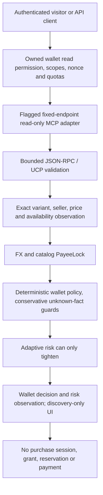

# V11.4.9 — Shopify Live MCP Discovery

## Result and scope

Implemented an opt-in Global Catalog connector at the fixed official endpoint,
`https://catalog.shopify.com/api/ucp/mcp`. It supports only `search_catalog`,
`lookup_catalog`, and `get_product`. **Discovery is not executable financial
authorization.** No cart, checkout, payment, account or order tools are exposed.

The starting working tree was clean, with V11.4.8 committed in `72cb1a2` (`feat:
harden IntentLock and prepare verified sandbox demo`). Created the requested
`feat/shopify-live-discovery` branch; no commit or push was made. Earlier reports'
working-tree descriptions are historical and do not describe this new baseline.

No production migration/deployment, payments, captures, refunds, merchant checkout,
credential inspection or existing financial-record changes occurred. Network
verification used anonymous read-only discovery/metadata requests only.

## Official contracts and live observations

Reviewed Shopify's [Global Catalog contract](https://shopify.dev/docs/agents/catalog/global-catalog),
[extension reference](https://shopify.dev/docs/agents/catalog/global-catalog-extension),
and the [UCP catalog specification](https://ucp.dev/2026-08-25/specification/shopping/catalog/).
The supported contract version is `2026-08-25`. Requests use JSON-RPC tools/call,
with server-controlled agent-profile metadata and a catalog argument. Responses
must contain structured UCP data and negotiated base/global capabilities. Prices
are positive integer ISO currency minor units, not major-unit decimal strings.
Descriptions/options/condition and enrichment fields are treated as inferred or
untrusted discovery signals, never verified hard policy evidence.

Read-only network calls succeeded for search, exact-variant lookup and get_product.
An observed search returned product `gid://shopify/p/dKsJrz8tM1kmxg2Wo3Bbv`, variant
`gid://shopify/ProductVariant/43202619408441`, seller
`gid://shopify/Shop/63551143993`, availability true and price **20999 USD minor
units ($209.99)**. Lookup and get_product agreed during this probe. This is an
observation, not a current price promise, merchant identity attestation or checkout.
No returned checkout URL was visited or executed.
The actual adapter module was also bundled in memory and exercised against all
three live tools. Its strict response validation and normalization returned that
same exact variant and minor amount with discoveryOnly true. No source file or
deployed configuration was altered for this smoke test. This verifies direct
read-only adapter connectivity, not a deployed browser/backend/payment flow.

The probe used Shopify's public example agent profile explicitly for investigation.
It is not a production profile, credential, merchant mapping or proof of application
registration. Deployments must configure their own reviewed, reachable profile.

Also evaluated [Shop MCP](https://shopify.dev/changelog/posts/add-shopping-and-shop-pay-checkout-to-any-agent-with-shop-mcp)
at `https://mcp.shop.com`. Live tools/list succeeded using protocol `2026-07-28`,
Mcp-Method and request metadata. Its list includes catalog tools alongside cart,
checkout, order/account and spending-request tools. Initial legacy-style requests
returned protocol/header errors; those were investigated without invoking financial
tools. **Shop MCP is not an adapter or fallback in this release.** Its wider surface
needs separate negotiation/authentication and financial-boundary review.

`node apps/worker/scripts/probe-shopify-catalog.mjs` reproduces anonymous read-only
Global Catalog calls and Shop MCP tool enumeration. It reads no environment secrets,
uses no wallet, and permits no mutation tool. It does not start database migrations.
Live network probes are separate from the default offline test suite.

## Architecture and trust boundaries

Only product query, destination country, display/localization currency and the
operator agent-profile URL are sent to Shopify. Wallet IDs, owner IDs, credentials,
limits, blocked/allowed brands, approval tokens and administrative credentials are
not forwarded as hidden filters. The existing query planner supplies product intent.
Browser-supplied endpoint, tool instructions, profile and ownership declarations
cannot change server execution. Tool response descriptions are data, not authority.

Existing capability/API ownership checks run before discovery. Anonymous visitors
may use this connector **only** for the flagged, wallet-scoped commerce search route.
Their existing payment rail, USD limits, nonce, expiry, issuance and other restrictions
remain. API delegates need the existing commerce scope and wallet read permission.
Foreign wallet attempts return the same 404 as missing resources before MCP access.

Additional SQL-backed quotas permit ten catalog requests/principal/minute and sixty
globally/minute, including refreshes. Existing access/IP/demo mutation quotas still
apply and may reject sooner. Provider 429 is surfaced without automatic retries.
No in-memory quota is treated as the distributed enforcement boundary.

New discovery policy/risk observations use server-generated catalog IDs and inherit
wallet ownership through the stored risk wallet ID. Existing wallet_decisions store
the transaction and exact normalized catalog observation, including minor-unit price
and seller identity. These are nonfinancial policy observations, not signed payment
receipts or invented PurchaseSessions. Existing audit/payment evidence is untouched.

The existing reservation/payment machinery is preserved. The recipient registry
does not resolve a trusted receiving account for this connector. Session creation
rejects the MCP connector; direct/queue session orchestration rejects it too. The
existing payment connector allowlist independently rejects external discovery.
Every returned candidate has executable authority disabled, even if policy is ALLOW.
No generic MCP execution route, browser administrator token or checkout link is added.

## Normalization and conservative policy

| Fact | Handling |
| --- | --- |
| Product / variant | Preserve distinct UPID/product GID and exact ProductVariant GID; ID-correlated lookup/get; reject contradictions and duplicate variants |
| Seller | Require structured Shop GID, name, domain and safe HTTPS storefront URL; preserve domain and storefront separately because custom storefront and myshopify domains can differ |
| Price | Require finite safe positive integer minor amount and valid currency; preserve original amount/digits and check lossless major-unit conversion; never use price_range or list_price as the payable variant price |
| Availability | Require explicit boolean; unavailable variants remain displayable but BLOCK; missing availability fails response validation |
| Quantity | 1/0 represents boolean sellability only, never an asserted stock count |
| Shipping | Preserve requested destination and optional shipping requirement; country filtering is not verified deliverability, final shipping price or merchant origin |
| Condition | Preserve supplied labels with INFERRED trust; never assert them as inspected goods condition |
| Enrichment | Preserve bounded inferred features, options and attributes separately; no promotion into hard category/brand/feature facts |
| Description | Preserve bounded text/HTML as untrusted or inferred text; React escapes it; never execute instructions or HTML |
| URLs | Omit checkout URLs; expose only safe same-storefront `/products/<slug>` links with the exact variant; remove tracking parameters; follow no seller/tool URLs server-side |

Brand/category/features are deliberately empty when not independently established.
Required features, allowed categories/brands therefore cannot be satisfied by inferred
text. Unknown brand also cannot clear a blocked-brand list. An available item with
sufficient verified monetary/identity facts can receive ALLOW or STEP-UP only when
the wallet imposes no unverifiable attribute restrictions. Risk preserves or tightens
that decision. Availability, PayeeLock enforcement, expiry/revocation, hard ceiling
and currency checks continue to fail closed.

The default Sony/Bose/Boat sandbox wallet has attribute restrictions, so live catalog
items generally BLOCK when their hard attributes cannot be established. This is
intentional; no string matching on a title or seller name invents a verified brand.
ALLOW remains a non-executable discovery evaluation, and STEP-UP does not issue a
purchase approval grant for these observations.

The adapter converts zero-, two- and three-decimal currencies for display while
retaining the original integer price. Existing financial/risk numeric columns have
their prior precision limitations; these observations cannot reserve or debit funds.
Exact source minor units are retained in catalog observation JSON, independently
of numeric analytics fields. This work does not change wallet/ledger money storage.
Unknown merchant origin is explicitly ZZ; a deployment-wide demo merchant-country
fallback cannot invent an origin for a different global-catalog merchant.
Unknown hard attributes remain blocked even if a misconfigured allowlist contains
an empty string. These guards do not rely on an inferred label matching a wallet rule.

## Transport hardening and configuration

- `SHOPIFY_GLOBAL_CATALOG_ENABLED=true` is required; absent/false means disabled.
- `SHOPIFY_CATALOG_AGENT_PROFILE_URL` must be a server-configured public HTTPS URL
  without embedded credentials, query or fragment. Host a reviewed UCP profile with
  the catalog search/lookup base capabilities and Shopify global extension. The
  operator must validate its ownership/reachability and Shopify access/rate tier.
- No browser-selectable MCP URL or configurable alternate endpoint. No Shopify
  credential is required for the anonymous reads verified here; none is inspected,
  stored or sent by the adapter. No automatic fallback to Shop MCP or a store URL.
- Only three enumerated methods; strict input schemas, max query 400 characters,
  ten input IDs/results, bounded product/variant arrays, 1 MiB response body and
  eight-second deadline. JSON and SSE JSON-RPC responses are supported. Errors,
  wrong IDs, absent structured content, malformed facts, unsupported versions or
  capability mismatches fail closed. No redirects, remote schema fetch or retry loop.
- Browser capability/HTTP CORS transport is unchanged. No database migration is
  introduced. The prior V11.4.4–.6 schema and infrastructure requirements remain.

Keep the flag off until the profile, network/subrequest budget, abuse controls and
operator monitoring are reviewed. Enabling discovery is not permission to enable
payments. The source flag is disabled by default; no deployed environment was changed.

## Frontend

Commerce Search retains the isolated PayPal catalog and adds the separately labeled
Shopify MCP connector. Disabled configuration is shown as unavailable. Live cards
show variant/product/shop IDs, merchant provenance, exact currency amount/minor units,
availability, requested destination, observation time and inferred-field labels.
Exact-variant refresh performs read-only lookup and a fresh policy/risk evaluation.
Loading, errors/timeouts, empty results and retry through search are explicit. Changing
wallet/connector clears stale candidate decisions; selection is disabled during a
request. A prominent notice distinguishes discovery from execution and fulfillment.

## Tests and validation

All default tests use isolated fixtures, not live product prices or merchant approvals.
Fixtures mirror documented and observed UCP structuredContent shapes. They are not
merchant mappings. New checks cover exact IDs, minor units (USD/JPY/KWD), unsafe or
absent identity/price/availability, inferred attributes and injection, version/capability
rejection, JSON/SSE, size limits, timeout/outage/429, tools/endpoint bypasses, quotas,
cross-user isolation, deterministic policy decisions, PayeeLock/risk tightening,
discovery audit observations and inability to create payment/session authority.

Browser fixtures intercept the official catalog URL with synthetic UCP data while
using actual ownership/policy/risk SQL handlers; all other external fetches remain
blocked. Added desktop/mobile cases show identity/price, refresh 4900 to 6900 minor
units and prove no wallet debit. The prior PayPal demo browser scenarios remain.

| Validation | Outcome |
| --- | --- |
| Complete automated suite, run 1 | PASS: 605 tests / 64 files, 69.54 seconds |
| Complete automated suite, run 2 | PASS: 605 tests / 64 files, 69.70 seconds |
| Desktop/mobile browser tests | PASS: 14 tests, 2.5 minutes; all 12 baseline cases retained |
| Real PostgreSQL integration suites | PASS: 78 tests / four files, PostgreSQL 17.6, 36.34 seconds |
| Fresh migrations / repeat / separate connections | PASS: 18 applied; journal repeat zero; 20 connections hold $98/$100; raw duplicate rejected atomically |
| Worker dry-run | PASS: final bundle 3544.16 KiB / gzip 625.31 KiB; initial sandbox log error resolved by rerun; no deployment |
| Next production build | PASS: all 16 pages generated |
| Strict Worker and frontend TypeScript | PASS: zero diagnostics, including final guard recheck |
| Global Catalog live read-only search/lookup/get_product | PASS: HTTP 200, matching observed variant/price/seller during probe |
| Shop MCP read-only tool enumeration | PASS after protocol metadata negotiation; not used by the adapter |
| Real merchant order, checkout, payment or fulfillment | NOT VERIFIED / deliberately disabled |
| Deployed profile/access tier/configuration and hosted CI | NOT VERIFIED; no deployment or credentials inspected |

All 545 baseline unit/SQL tests remain. Added 60: 56 adapter/normalization/policy
tests, two gate/limiter tests and two full-schema ownership/discovery HTTP tests.
Two new browser cases (desktop/mobile) supplement the 12 baseline browser cases.
An initial browser run passed 13/14 and identified wrapping overflow in the new
mobile catalog card. Scoped responsive styles corrected it; the full rerun passed.
Final conservative origin/empty-attribute guard checks also passed all 56 focused
MCP regressions. No baseline tests were removed, skipped or weakened.

The server restart interrupted initial validation, so those incomplete runs are not
counted as successful evidence. The pre-existing disposable PostgreSQL temporary
directory had been partially cleaned; a fresh isolated cluster was initialized for
this release instead of repairing or using any production database.
All harness-created PostgreSQL databases were dropped by their tests, and the fresh
temporary server was stopped. Browser test servers exited after the passing suite.

## Files changed

- `apps/worker/src/commerce/shopify-mcp.ts`, `catalog-policy.ts`, `types.ts`,
  `registry.ts`, `routes.ts`
- `apps/worker/src/access/gate.ts`; `sessions/routes.ts`, `sessions/orchestrator.ts`
- `apps/web/app/commerce/page.tsx`, `commerce/commerce.css` (scoped responsive cards and wrapping for long catalog identifiers)
- `apps/worker/src/tests/shopify-mcp-fixture.ts`, `shopify-mcp.test.ts`,
  `financial-access.test.ts`, `release-http-integration.test.ts`
- `apps/worker/browser/bridge.fixture.ts`; `apps/web/e2e/sandbox.spec.ts`
- `apps/worker/scripts/probe-shopify-catalog.mjs`; this report

## Release decision and remaining limitations

**GO for reviewed, feature-flagged read-only discovery after configuration gates;
NO-GO for Shopify purchasing.** Discovery connectivity and isolated tests do not
establish verified merchant onboarding, recipient binding, final shipping/taxes,
inventory/order commitment, checkout submission, payment, order webhooks or fulfillment.
Missing hard attribute provenance is not fixed by adding inferred brand/features.
Future contracts must provide independent attestations and pass the existing
ownership, quote/risk, reservation, recipient and verified-settlement boundaries.

The prior dependency-advisory, actual PayPal account/permissions, distributed
queue/Neon/Upstash, recovery/retention and unbound historical-obligation gates remain.
This release adds no refunds, automatic reconciliation, deployment or migration.
It does not remove V11.4.8's live-payments NO-GO decision.
